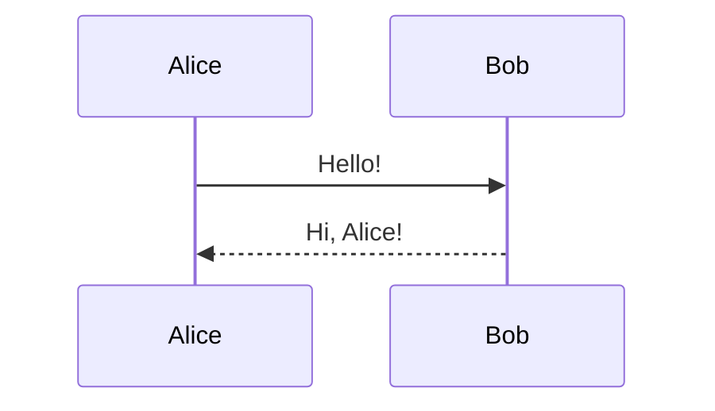
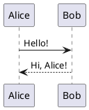

# Markdown diagram test

This ordinary Markdown document contains two sequence diagrams.

## Mermaid

## PlantUML

## Try editing

Run `:MdRender toggle` to switch between this source and its rendered view.
Run `:vertical MdRender split` to edit beside a live preview.
